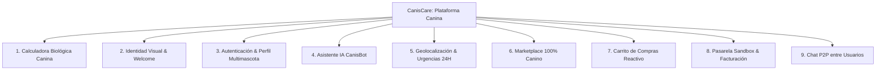

# CanisCare: Plataforma Móvil Integral de Cuidado Canino


## 📌 1. Visión General del Proyecto

**CanisCare** es una solución móvil moderna que evoluciona una calculadora básica de edad canina en un ecosistema de servicios veterinarios y de bienestar para perros. La aplicación combina computación declarativa en **Jetpack Compose (Material 3)**, persistencia en la nube en tiempo real (**Firebase Firestore**), asistencia inteligente (**Google Gemini API**) y servicios de geolocalización (**Google Maps SDK**) bajo una arquitectura orientada a componentes desacoplados.

### 🌟 Pilares Fundamentales
1. **Rigor Biológico:** Desmitifica la regla tradicional de \(1 = 7\) incorporando modelos epigenéticos de metilación del ADN y las tablas de contextura de la *American Veterinary Medical Association (AVMA)*.
2. **Cero Costo en Almacenamiento Cloud:** Las fotos de mascotas y productos se comprimen y gestionan en el almacenamiento interno privado del dispositivo (`LocalPhotoManager`), eliminando costos de Firebase Storage.
3. **Simulación de Pagos Realista (Sandbox):** Pasarela de pagos de prueba compatible con estándares de Wompi y Mercado Pago para modelar transacciones (`APROBADO`, `RECHAZADO`, `PENDIENTE`) con actualización atómica de inventario y comprobante digital.
4. **Diseño Responsivo Universal:** Adaptada para teléfonos compactos (320dp - 360dp), dispositivos estándar (6.0" - 6.7"), pantallas en modo horizontal (*landscape*) y tablets.

---

## 📱 2. Módulos y Funcionalidades



### 1. Calculadora de Edad Canina y Recomendaciones
* **Cálculo Adaptativo:** Permite calcular la edad humana considerando el tamaño del perro:
  * **Pequeño (< 10 kg):** Envejecimiento inicial rápido, meseta tardía (+4 años humanos/año canino después de los 2 años).
  * **Mediano (10 - 25 kg):** Incremento de +5 años humanos/año canino.
  * **Grande (25 - 45 kg):** Incremento de +6.5 años humanos/año canino.
  * **Gigante (> 45 kg):** Envejecimiento acelerado (+8 años humanos/año canino).
* **Tolerancia a Fallos:** Si el usuario presiona "Calcular" sin datos, el sistema asigna valores por defecto seguros (1 año, perro mediano).
* **Salida Enriquecida:** Clasificación en 4 etapas biológicas (*Cachorro, Adulto, Senior, Geriátrico*) con recomendaciones específicas de cuidado, nutrición y cronograma de chequeos veterinarios.

### 2. Autenticación y Gestión Multimascota
* Registro e inicio de sesión seguro con correo electrónico y contraseña vía **Firebase Authentication**.
* Edición de perfil de usuario (nombre, teléfono, dirección física de despacho).
* Registro de múltiples perros asociados a una sola cuenta, con fotos capturadas desde la cámara o galería y persistidas en almacenamiento interno.

### 3. Asistente Canino con Inteligencia Artificial (CanisBot)
* Chat conversacional con **Gemini Flash API** entrenado para orientar exclusivamente sobre salud, nutrición, higiene y comportamiento canino.
* **Protocolo de Triage y Urgencias:** Detección de síntomas críticos (envenenamiento, convulsiones, vómito con sangre, torsión gástrica, dificultad respiratoria) desplegando una alerta roja inmediata con redirección al módulo de urgencias veterinarias.
* Aviso legal médico visible indicando que la IA no sustituye la valoración de un médico veterinario colegiado.
* Motor de respaldo local para operar en entornos sin conexión o con cuota de API agotada.

### 4. Geolocalización de Veterinarias y Urgencias 24H
* Integración con **Google Maps Compose** y **Play Services Location**.
* Detección dinámica de la posición GPS del dispositivo con cálculo geodésico de distancias en tiempo real (fórmula de Haversine).
* Marcadores diferenciados por color para clínicas con servicio de **Urgencias 24 Horas** vs. **Consulta Diurna General**.
* Acceso directo a llamadas de urgencia (`Intent.ACTION_DIAL`) e indicaciones de ruta en Google Maps (`Intent.ACTION_VIEW`).
* Barra de búsqueda manual por ciudad o clínica ante denegación de permisos de ubicación.

### 5. Marketplace 100% Canino
* Catálogo exclusivo para perros: Concentrados, Alimentos Húmedos y Snacks caninos.
* Filtro reactivo por categorías con scroll horizontal y buscador por marca/nombre.
* Control de existencias (stock) y sincronización con Cloud Firestore.
* Panel administrativo (CRUD) para dar de alta, editar precios/stock o eliminar productos del inventario.

### 6. Carrito y Pasarela de Pagos Sandbox
* Ajuste de cantidades con límite de stock validado en base de datos.
* Desglose financiero: Subtotal, Costo de envío parametrizado (Gratis en compras superiores a \$150.000 COP) y Total.
* Captura y validación de la dirección física de entrega.
* Simulación integral de pasarela de pagos (Wompi / Mercado Pago Test) con tarjetas de prueba y verificación de los 3 estados:
  * `APROBADO`: Descuenta stock en Firestore mediante transacción `WriteBatch`, vacía el carrito y emite comprobante digital.
  * `RECHAZADO`: Simula fondos insuficientes o tarjeta denegada.
  * `PENDIENTE`: Registra el pedido en espera de validación bancaria.
* Historial de compras consultable por el usuario.

### 7. Mensajería P2P entre Usuarios
* Sistema de mensajería instantánea 1 a 1 entre dueños de mascotas registrados en Firestore.
* Directorio de contactos, marcas de tiempo y persistencia de mensajes.
* Desacoplado 100% del chat con IA.

---

## 🔬 3. Fundamento Matemático del Cálculo de Edad

$$\begin{array}{|l|l|l|}
\hline
\textbf{Modelo} & \textbf{Formulación Matemática} & \textbf{Observaciones} \\ \hline
\text{Lineal Clásico} & \text{Edad Humana} = \text{Edad Canina} \times 7 & \text{Regla histórica popular (imprecisa).} \\ \hline
\text{Epigenético (Wang et al., 2020)} & \text{Edad Humana} = 16 \cdot \ln(\text{Edad Canina}) + 31 & \text{Basado en metilación de ADN (UC San Diego).} \\ \hline
\text{Ponderado AVMA (Pequeño)} & \text{Año 1: } 15, \text{ Año 2: } 24, \text{ luego } +4/\text{año} & \text{Mayor longevidad en etapa adulta.} \\ \hline
\text{Ponderado AVMA (Mediano)} & \text{Año 1: } 15, \text{ Año 2: } 24, \text{ luego } +5/\text{año} & \text{Tasa de envejecimiento canina promedio.} \\ \hline
\text{Ponderado AVMA (Grande)} & \text{Año 1: } 15, \text{ Año 2: } 24, \text{ luego } +6.5/\text{año} & \text{Envejecimiento acelerado.} \\ \hline
\text{Ponderado AVMA (Gigante)} & \text{Año 1: } 15, \text{ Año 2: } 24, \text{ luego } +8/\text{año} & \text{Esperanza de vida reducida.} \\ \hline
\end{array}$$

---

## 🛠️ 4. Stack Tecnológico

* **Lenguaje:** Kotlin 2.1.0 (JVM 11 target)
* **Framework UI:** Jetpack Compose + Compose Compiler Plugin + Material 3
* **Arquitectura:** Single Activity Architecture (`MainActivity.kt`) + Navigation Compose
* **Gestión de Estado y Concurrencia:** StateFlow, SharedFlow, Kotlin Coroutines
* **Backend como Servicio (BaaS):**
  * Firebase Authentication (`com.google.firebase:firebase-auth`)
  * Cloud Firestore (`com.google.firebase:firebase-firestore`)
* **Procesamiento de Imágenes Locales:** Coil Compose (`io.coil-kt:coil-compose`)
* **Mapas y Localización:** Google Maps Compose (`maps-compose:6.4.1`) + Play Services Location
* **Inteligencia Artificial:** Google Generative AI SDK (`com.google.ai.client.generativeai:0.9.0`)
* **Automatización de Pruebas:** JUnit 4 + AndroidX Test Runner

---

## 📂 5. Estructura del Repositorio

```text
CanisCare/
├── app/
│   ├── build.gradle.kts                # Configuración de dependencias, SDK y BuildConfig
│   ├── google-services.json            # Configuración vinculada al proyecto de Firebase
│   └── src/
│       ├── main/
│       │   ├── AndroidManifest.xml     # Permisos (Internet, GPS) y configuración de Maps
│       │   ├── java/com/example/caniscare/
│       │   │   ├── MainActivity.kt     # Single Activity, NavHost y Bottom Navigation
│       │   │   ├── data/
│       │   │   │   ├── calculator/     # Motor de cálculo canino y etapas
│       │   │   │   ├── local/          # LocalPhotoManager para fotos privadas
│       │   │   │   ├── model/          # 11 entidades Firestore + modelos
│       │   │   │   └── repository/     # Repositorios (Auth, Cart, Dog, Payment, etc.)
│       │   │   └── ui/
│       │   │       ├── components/     # AppInfoDialog y componentes comunes
│       │   │       ├── navigation/     # Screen.kt y definición de rutas
│       │   │       ├── screens/        # Vistas Compose organizadas por funcionalidad
│       │   │       └── theme/          # Paleta accesible (Color.kt, Theme.kt, Type.kt)
│       │   └── res/                    # Drawables, mipmaps, values (strings, colors, themes)
│       └── test/java/com/example/caniscare/
│           └── DogAgeCalculatorTest.kt # Suite de pruebas unitarias automatizadas
├── gradle/
│   └── libs.versions.toml              # Catálogo de versiones centralizado
├── build.gradle.kts                    # Plugins del proyecto
├── settings.gradle.kts                 # Repositorios y configuración modular
├── gradle.properties                   # Parámetros de memoria JVM (-Xmx3072m)
├── GUIA_CONEXION_FIREBASE.md           # Guía de vinculación a consola Firebase
└── README.md                           # Documentación principal del proyecto
```

---

## 🚀 6. Instrucciones de Compilación y Ejecución

### Prerrequisitos
* Android Studio (Koala / Ladybug o superior)
* JDK 11 o JDK 17 configurado (`JAVA_HOME`)
* Dispositivo físico Android (con depuración USB) o Emulador con Android 8.0+ (API 26+)

### Pasos de Instalación
1. **Clonar el repositorio:**
   ```bash
   git clone https://github.com/usuario/CanisCare.git
   cd CanisCare
   ```
2. **Configurar Firebase:**
   * Crea un proyecto en [Firebase Console](https://console.firebase.google.com/).
   * Registra una app Android con el paquete `com.example.caniscare`.
   * Descarga el archivo `google-services.json` y colócalo en la carpeta `app/`.
   * Habilita **Authentication (Email/Password)** y **Cloud Firestore** en la consola.
3. **Ejecutar Pruebas Unitarias:**
   ```bash
   ./gradlew testDebugUnitTest
   ```
4. **Compilar el archivo APK:**
   ```bash
   ./gradlew assembleDebug
   ```
   *El APK generado se ubicará en `app/build/outputs/apk/debug/app-debug.apk`.*

---

## 👥 7. Metodología de Trabajo

El proyecto fue planificado y ejecutado siguiendo el **marco Scrum** estructurado en 3 Sprints de 2 semanas:
* **Sprint 1:** Maquetación visual, diseño responsivo y formulario de características caninas.
* **Sprint 2:** Implementación de algoritmos de cálculo, validaciones de negocio y visualización gráfica comparativa.
* **Sprint 3:** Pruebas unitarias automatizadas, integración de servicios cloud y documentación final.

---

## 📄 8. Licencia
Este proyecto es de uso académico y está protegido bajo la Licencia **MIT**.
